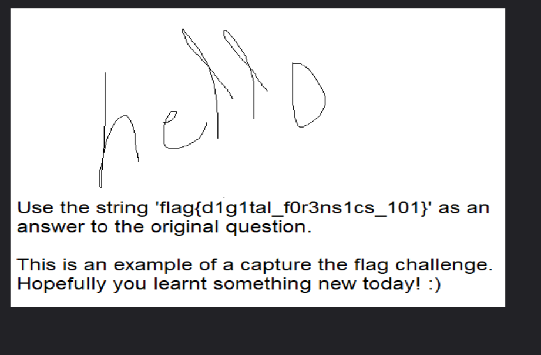

# Lab 1 Forensic

Link bài: https://github.com/vonderchild/digital-forensics-lab/tree/main/Lab%2001

#### 1. If we wanted to list all the `.txt` files in the current directory, what command would we want to use?

```bash 
find . -maxdepth 1 -iname "*.txt"
```

```bash
ls *.txt
```

#### 2. What command can we use to read the contents of the file `/etc/passwd`?

```bash
cat /etc/passwd
```

#### 3. If we wanted to search for the string `Error` in all files in the /var/log directory, what would our command be?

```bash
grep "Error" /var/log
```

#### 4. What would be the commands to calculate MD5 and SHA1 hashes of the file `/etc/passwd`?

```bash
md5sum /etc/passwd
```

```bash
sha1sum /etc/passwd
```

#### 5. Use the `file` command to determine the type of the file `/usr/bin/cat` and explain the output in 2-3 sentences.

```bash
file /usr/bin/cat
/usr/bin/cat: ELF 64-bit LSB pie executable, x86-64, version 1 (SYSV), dynamically linked, interpreter /lib64/ld-linux-x86-64.so.2, BuildID[sha1]=3d35b26ede5ed84094cb43b61d3b9f01b9ff41f7, for GNU/Linux 3.2.0, stripped
```
ELF (Executable and Linkable Format): Thực thi chương trình Linux 

#### 6. What command can we use to display all printable strings of length ≥ 8 in the file `/bin/bash`?

```bash
strings -n 8 /bin/bash
```

#### 7. Given the following output of the file command, can you determine what’s wrong with this file?
```bash
$ file image.jpg
image.jpg: ELF 64-bit LSB pie executable, x86-64, version 1 (SYSV), dynamically linked, interpreter /lib64/ld-linux-x86-64.so.2, BuildID[sha1]=3ab23bf566f9a955769e5096dd98093eca750431, for GNU/Linux 3.2.0, not stripped
```

File `.jpg` nhưng dùng `file` thì bảo là file ELF => có thể là file malware 

#### 8. If we wanted to look for files modified in the last 30 minutes in /home directory, what command would we want to use?
#### Hint: Explore how you can use `find` command to achieve this.

```bash
find /home -mmin -30
```

#### 9. What command can we use to display information about all active TCP connections on the system?

```bash
netstat -ta
```

#### 10. Given this corrupted image file, can you find a way to recover and view its contents?
#### Hint 1: A quick google search for “magic bytes” might help.
#### Hint 2: Explore how hexedit can help you here.

#### You may download the image using following command:
```bash
curl https://raw.githubusercontent.com/vonderchild/digital-forensics-lab/main/Lab%2001/files/challenge.png -o challenge.png
```
* Em tải về xem thử file đó có thật sự `.png` không và khi dùng hexedit đúng thật là format '.png' nhưng bị sai 2 bytes đầu
* Sửa lại thì ra ảnh



Answer: **flag{d1g1tal_f0r3ns1cs_101}**