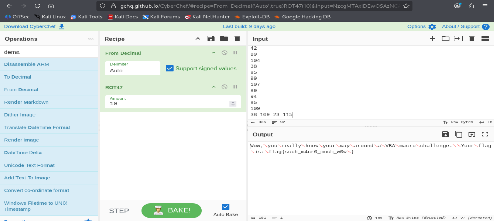
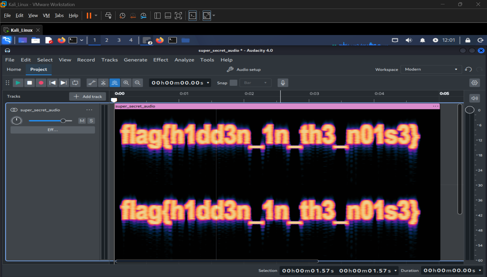

# Lab 3 Forensic

Link bài: https://github.com/vonderchild/digital-forensics-lab/tree/main/Lab%2003

### 1. A phishing attack has been reported in your organization, where an employee received a malicious Word document in an email that appeared to come from a trusted source. The employee opened the document which had macros in it, resulting in the attacker gaining access to the employee’s computer. A secret which will reveal the attacker's identity, is embedded inside the macro code. You are tasked with analyzing the macro code and extracting the embedded secret. The secret has the format `flag{s0me_str1ng}`.

Đầu tiên là sài tool `oleid` và `olevba` trước
```bash
oleid YearlyBonus.docm                                                         
oleid 0.60.1 - http://decalage.info/oletools
THIS IS WORK IN PROGRESS - Check updates regularly!
Please report any issue at https://github.com/decalage2/oletools/issues

Filename: YearlyBonus.docm
WARNING  For now, VBA stomping cannot be detected for files in memory
--------------------+--------------------+----------+--------------------------
Indicator           |Value               |Risk      |Description               
--------------------+--------------------+----------+--------------------------
File format         |MS Word 2007+ Macro-|info      |                          
                    |Enabled Document    |          |                          
                    |(.docm)             |          |                          
--------------------+--------------------+----------+--------------------------
Container format    |OpenXML             |info      |Container type            
--------------------+--------------------+----------+--------------------------
Encrypted           |False               |none      |The file is not encrypted 
--------------------+--------------------+----------+--------------------------
VBA Macros          |Yes, suspicious     |HIGH      |This file contains VBA    
                    |                    |          |macros. Suspicious        
                    |                    |          |keywords were found. Use  
                    |                    |          |olevba and mraptor for    
                    |                    |          |more info.                
--------------------+--------------------+----------+--------------------------
XLM Macros          |No                  |none      |This file does not contain
                    |                    |          |Excel 4/XLM macros.       
--------------------+--------------------+----------+--------------------------
External            |0                   |none      |External relationships    
Relationships       |                    |          |such as remote templates, 
                    |                    |          |remote OLE objects, etc   
--------------------+--------------------+----------+--------------------------
olevba YearlyBonus.docm 
olevba 0.60.2 on Python 3.14.8 - http://decalage.info/python/oletools
===============================================================================
FILE: YearlyBonus.docm
Type: OpenXML
WARNING  For now, VBA stomping cannot be detected for files in memory
-------------------------------------------------------------------------------
VBA MACRO ThisDocument.cls 
in file: word/vbaProject.bin - OLE stream: 'VBA/ThisDocument'
- - - - - - - - - - - - - - - - - - - - - - - - - - - - - - - - - - - - - - - 
(empty macro)
-------------------------------------------------------------------------------
VBA MACRO NewMacros.bas 
in file: word/vbaProject.bin - OLE stream: 'VBA/NewMacros'
- - - - - - - - - - - - - - - - - - - - - - - - - - - - - - - - - - - - - - - 
Sub ConvertByteArrayToString(byteArray() As Byte)
    Dim str As String
    str = "Oh, and almost forgot, here's something little cryptic for you: " + StrConv(byteArray, vbUnicode)
    MsgBox str
End Sub


Sub doShenanigans()
    Dim byteArray(0 To 100) As Byte
    byteArray(0) = 77
    byteArray(1) = 101
    byteArray(2) = 109
    byteArray(3) = 34
    byteArray(4) = 22
    byteArray(5) = 111
    byteArray(6) = 101
    byteArray(7) = 107
    byteArray(8) = 22
    byteArray(9) = 104
    byteArray(10) = 91
    byteArray(11) = 87
    byteArray(12) = 98
    byteArray(13) = 98
    byteArray(14) = 111
    byteArray(15) = 22
    byteArray(16) = 97
    byteArray(17) = 100
    byteArray(18) = 101
    byteArray(19) = 109
    byteArray(20) = 22
    byteArray(21) = 111
    byteArray(22) = 101
    byteArray(23) = 107
    byteArray(24) = 104
    byteArray(25) = 22
    byteArray(26) = 109
    byteArray(27) = 87
    byteArray(28) = 111
    byteArray(29) = 22
    byteArray(30) = 87
    byteArray(31) = 104
    byteArray(32) = 101
    byteArray(33) = 107
    byteArray(34) = 100
    byteArray(35) = 90
    byteArray(36) = 22
    byteArray(37) = 87
    byteArray(38) = 22
    byteArray(39) = 76
    byteArray(40) = 56
    byteArray(41) = 55
    byteArray(42) = 22
    byteArray(43) = 99
    byteArray(44) = 87
    byteArray(45) = 89
    byteArray(46) = 104
    byteArray(47) = 101
    byteArray(48) = 22
    byteArray(49) = 89
    byteArray(50) = 94
    byteArray(51) = 87
    byteArray(52) = 98
    byteArray(53) = 98
    byteArray(54) = 91
    byteArray(55) = 100
    byteArray(56) = 93
    byteArray(57) = 91
    byteArray(58) = 36
    byteArray(59) = 0
    byteArray(60) = 0
    byteArray(61) = 79
    byteArray(62) = 101
    byteArray(63) = 107
    byteArray(64) = 104
    byteArray(65) = 22
    byteArray(66) = 92
    byteArray(67) = 98
    byteArray(68) = 87
    byteArray(69) = 93
    byteArray(70) = 22
    byteArray(71) = 95
    byteArray(72) = 105
    byteArray(73) = 48
    byteArray(74) = 22
    byteArray(75) = 92
    byteArray(76) = 98
    byteArray(77) = 87
    byteArray(78) = 93
    byteArray(79) = 113
    byteArray(80) = 105
    byteArray(81) = 107
    byteArray(82) = 89
    byteArray(83) = 94
    byteArray(84) = 85
    byteArray(85) = 99
    byteArray(86) = 42
    byteArray(87) = 89
    byteArray(88) = 104
    byteArray(89) = 38
    byteArray(90) = 85
    byteArray(91) = 99
    byteArray(92) = 107
    byteArray(93) = 89
    byteArray(94) = 94
    byteArray(95) = 85
    byteArray(96) = 109
    byteArray(97) = 38
    byteArray(98) = 109
    byteArray(99) = 23
    byteArray(100) = 115
    
    For iter = 0 To 100
        byteArray(iter) = byteArray(iter) + 3
    Next
    
    Call ConvertByteArrayToString(byteArray)
End Sub

Sub AutoOpen()

    Dim str As String
    str = "You have been hacked!"
    MsgBox str
    
    Call doShenanigans

End Sub
+----------+--------------------+---------------------------------------------+
|Type      |Keyword             |Description                                  |
+----------+--------------------+---------------------------------------------+
|AutoExec  |AutoOpen            |Runs when the Word document is opened        |
|Suspicious|Call                |May call a DLL using Excel 4 Macros (XLM/XLF)|
+----------+--------------------+---------------------------------------------+
```
Em nghĩ chỉ cần copy bytes và lên cyberchef là xong nhưng bytes đầu và bytes+3 nó cũng không ra gì liên quan tới flag hết

Xong ngồi xem lại thì thấy byte 22 nếu muốn thành cách nó phải là byte 32 vậy nên thử +10 và ra flag



Answer: **flag{such_m4cr0_much_w0w}**

### 2. A mole within the government has leaked top secret information to a spy. The mole, aware of spycraft techniques, used steganography to hide the information within an image, which he then slipped to his handler. The spy received the image and pasted it into a PowerPoint document, covering it with multiple random images to conceal it. One of our spies has gained access to the enemy spy's computer and recovered the PowerPoint document. Your mission is to extract the first image, extract the top secret information as well as the name and location of his source inside the government.

Em unzip cái file và xem thử thì thấy  /ppt/media có đúng 1 file `.jpg` nên sài exiftool thì thấy dòng 
```bash
Artist                          : Michael Scott
Y Cb Cr Positioning             : Centered
GPS Version ID                  : 2.3.0.0
GPS Latitude                    : 34 deg 12' 39.33"
GPS Longitude                   : 118 deg 26' 11.15"
```

Lên google map tra thì thấy 


Answer:
* Name: **Michael Scott**
* Address: **6H67+9CG Los Angeles, California, Hoa Kỳ**

### 3. Provided with the audio file from the Audio Steganography section, figure out how you can view the spectogram and recover the flag using Audacity. Submit a screenshot.



Answer: **flag{h1dd3n_1n_th3_n01s3}**
